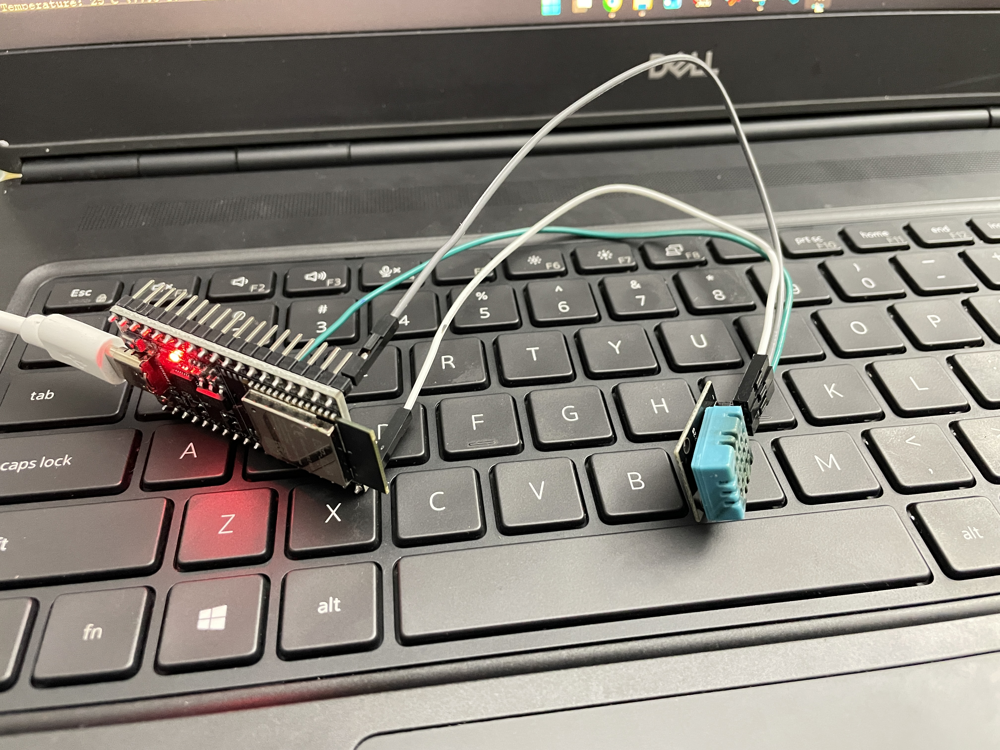
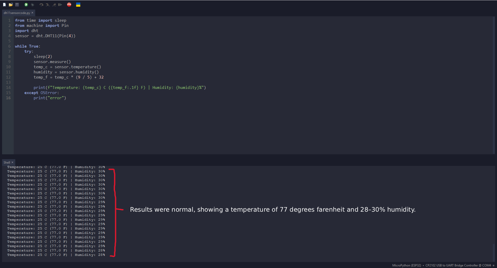
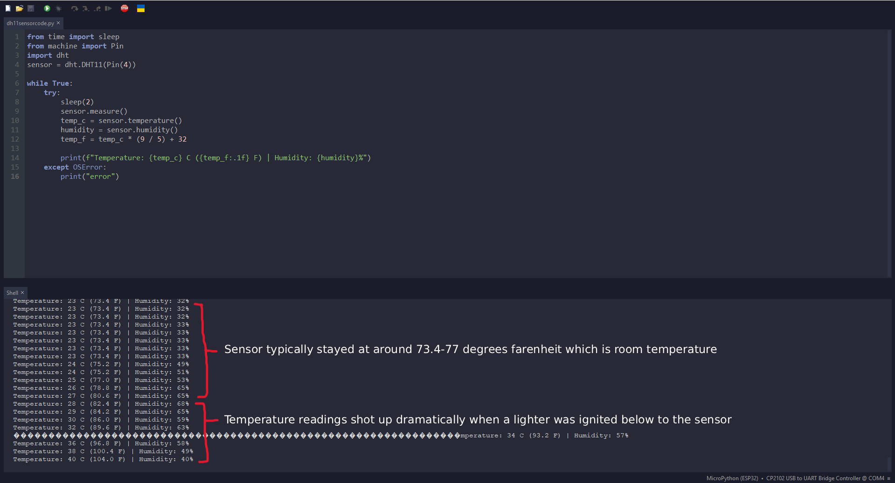
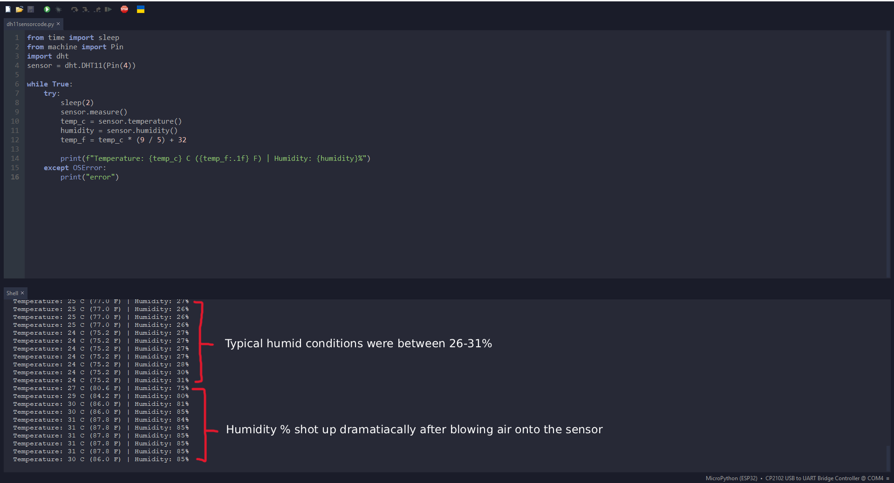

# ESP32 DHT11 MicroPython Monitor

I wrote a MicroPython script in Thonny to read temperature (°C/°F) and relative humidity (%) from a DHT11 sensor on an ESP32.

## Wiring
* **VCC (+)** -> `3V3`
* **DATA (out)** -> `GPIO 4`
* **GND (-)** -> `GND`

## Tests
* **Baseline:** Held steady around **25 °C (77.0 °F)** and **28%–30%** humidity at room temperature.
  
* **Heat:** Rose from **23 °C (73.4 °F)** to **40 °C (104.0 °F)** with a lighter underneath.
  
* **Humidity:** Jumped from **26%–31%** to **85%** after I breathed onto the sensor.
  
